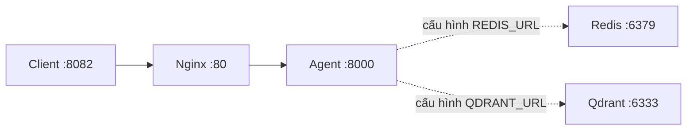

# Day 14 Lab — Mission Answers

CP0 đã hoàn thành: Python chạy trong Ubuntu WSL2 (`posix`), Docker Engine phản hồi và hello-world chạy thành công. Tiến độ được ghi trong [LAB_PROGRESS.md](LAB_PROGRESS.md).

## Part 1 — Localhost vs Production (CP1)

### Exercise 1.1 — Anti-patterns

Trong `01-localhost-vs-production/develop/app.py`:

1. Dòng 19–20 nhúng key giả và database URL có mật khẩu trong source; nếu là secret thật, Git history vẫn giữ lại sau khi xóa.
2. Dòng 23–24 cố định DEBUG và MAX_TOKENS; cùng artifact khó chạy ở các môi trường khác nhau.
3. Dòng 37 in API key ra log; người có quyền xem log cũng đọc được secret.
4. Không có `/health` và `/ready`; platform không phân biệt process còn sống với service sẵn sàng.
5. Dòng 56 bind `localhost`; container không nhận kết nối từ ngoài network namespace.
6. Dòng 57 cố định port 8000, không đọc PORT của nền tảng.
7. Dòng 58 bật reload cho mọi môi trường; reload là công cụ phát triển, làm phát sinh process giám sát không cần thiết khi deploy.
8. Chưa có lifecycle cleanup cho tài nguyên khi shutdown.

### Exercise 1.2 — Kết quả chạy thật

Chạy trong Ubuntu bằng Python 3.11.18; dùng uvicorn CLI để tránh reload khi tự động hóa. Tái hiện: `python scripts/check_examples.py cp1` sau khi kích hoạt môi trường lab.

- `POST /ask?question=Hello` → **200**, có `answer`.
- `POST /ask` với JSON → **422**, thiếu `query.question`, đúng lưu ý K5.
- Bản production: JSON `/ask` → **200**, `/health` → **200**, `/ready` → **200**.
- Header, body đầy đủ: [evidence/cp1.json](evidence/cp1.json).

### Exercise 1.3 — So sánh

| Feature | Develop | Production | Vì sao quan trọng? |
| --- | --- | --- | --- |
| Config | Giá trị cố định trong app.py | `Settings` đọc env trong config.py | Đổi staging/production mà không sửa source |
| Secrets | Source và log chứa key giả | Đọc env, log độ dài câu hỏi | Giảm nguy cơ lộ credential |
| Bind / port | localhost:8000 | HOST mặc định 0.0.0.0, PORT từ env | Nhận kết nối qua container/cloud |
| Health | Không có | `/health`, `/ready` | Liveness quyết định restart, readiness quyết định route traffic |
| Logging | print | logging với định dạng JSON | Dễ gom log và tìm event |
| Shutdown | Không có cleanup | lifespan startup/shutdown | Đóng kết nối sau khi hoàn thành request |

Ví dụ sửa cụ thể: `develop/app.py:57` dùng `port=8000`; `production/app.py` dùng `port=settings.port`, còn `production/config.py` đọc `os.getenv("PORT", "8000")`.

Nhận xét khi đọc code: bản mẫu production chưa phải thiết kế cuối cùng. Nó ghép JSON bằng chuỗi format nên message có dấu nháy có thể làm log không hợp lệ; `/ready` mới kiểm tra cờ startup. Khi import qua uvicorn CLI, signal handler tự đăng ký có thể ghi đè handler của uvicorn (runner phải giới hạn thời gian dọn process). CP5 cần formatter `json.dumps`, kiểm tra Redis thật và giữ cơ chế signal của server.

Stateless nghĩa là các instance chia sẻ state bên ngoài process; nếu lưu RAM thì request sau đến instance khác sẽ thiếu history. Dev/prod parity là giảm khác biệt runtime, dependency và dịch vụ phụ thuộc giữa môi trường phát triển và triển khai.

## Part 2 — Docker (CP2)

### Exercise 2.1 — Dockerfile cơ bản

1. Base image: `python:3.11`, gồm Python và hệ điều hành nền; tag có thể thay đổi theo bản cập nhật.
2. Working directory: `/app`; các lệnh COPY/RUN và command làm việc từ đó.
3. Copy requirements trước source để layer cài dependency được tái dùng khi chỉ sửa code. `pip --no-cache-dir` không vô hiệu hóa Docker layer cache.
4. CMD cung cấp command/argument mặc định, bị thay bằng argument sau tên image khi `docker run`. ENTRYPOINT xác định chương trình chính; argument runtime thường được nối vào nó. Exec form giúp signal đến đúng process; shell phải dùng `exec` khi khởi động server.

### Exercise 2.2–2.3 — Build và số đo

Build từ gốc repo:

```bash
docker build -f 02-docker/develop/Dockerfile -t my-agent:develop .
docker build -f 02-docker/production/Dockerfile -t my-agent:advanced .
docker images my-agent
```

| Image | SIZE từ docker images | Quy về MB thập phân để so sánh |
| --- | --- | ---: |
| my-agent:develop | 1.67GB | khoảng 1670 |
| my-agent:advanced | 240MB | khoảng 240 |

Theo số SIZE hiển thị đã làm tròn, giảm khoảng **85,63%**: `(1670 - 240) / 1670 × 100`.
Docker Engine này trả trường inspect `.Size` khác SIZE của `docker images`: lần lượt 426320129 và 57409181 byte. File bằng chứng lưu cả hai nguồn; không trộn chúng khi tính phần trăm. Bảng chính dùng `docker images` theo yêu cầu CP2.

Stage builder của production cài gcc/libpq-dev và pip dependencies vào `/root/.local`; runtime bắt đầu lại từ Python slim, chỉ copy packages/source, chạy user appuser. Runtime không mang theo các layer cài build tools. Slim base cũng góp phần giảm image; multi-stage không tự làm nhỏ nếu vẫn copy toàn bộ builder.

Container develop nhận `POST /ask?question=What%20is%20Docker` → 200. Output gốc của `docker images`, kích thước inspect và HTTP response: [evidence/cp2.json](evidence/cp2.json). Tái tạo kiểm tra: `python scripts/check_docker.py` khi stack CP2 đang chạy ở 8082.

### Exercise 2.4 — Compose stack



Compose tạo network nội bộ và volume cho Redis/Qdrant, đợi healthcheck của chúng trước khi bật agent. App mock mẫu chưa thực sự gọi Redis/Qdrant; đây là các dependency được khai báo cho kiến trúc mở rộng.

Windows từ chối bind host port 80. Đã sửa mapping thành `127.0.0.1:${HTTP_PORT:-8082}:80`, bỏ mapping 443 vì chưa cấu hình TLS. Qua Nginx `http://localhost:8082/health` → **200**; JSON `POST /ask` → **200**. Chạy bằng project `k5-day14-docker`, đã `down -v` sau khi lưu bằng chứng. Muốn mount dữ liệu ngoài image dùng bind mount hoặc named volume; `.dockerignore` loại venv/cache/secret để không đưa chúng vào build context.

## Part 4 — API Security (CP3)

### Exercise 4.1 — API key

`04-api-gateway/develop/app.py` dùng dependency `verify_api_key` đọc `X-API-Key` và so với env `AGENT_API_KEY`. Thiếu/sai key bị từ chối trước khi gọi LLM. Rotate bằng cách tạo key ngẫu nhiên mới, cập nhật env trên server và client rồi restart/redeploy; thu hồi key cũ, không ghi key vào source hay bài nộp.

Output thật từ `curl -i` (đầy đủ trong [evidence/cp3-http.txt](evidence/cp3-http.txt)):

```text
HTTP/1.1 401 Unauthorized
{"detail":"Missing API key. Include header: X-API-Key: <your-key>"}

HTTP/1.1 200 OK
{"question":"Hello","answer":"Đây là câu trả lời từ AI agent (mock). Trong production, đây sẽ là response từ OpenAI/Anthropic."}
```

### Exercise 4.2–4.3 — JWT và rate limit

Lấy token ở `POST /auth/token` bằng tài khoản demo `student`, sau đó gửi Bearer token cho `/ask`. Token được ký HS256, chứa `sub`, `role`, `iat`, `exp`; server kiểm chữ ký và hạn dùng. Runner tạo JWT_SECRET ngẫu nhiên trong env và không ghi token ra file.

Kết quả vòng lặp: **10 request 200**, request thứ **11 trả 429**. [evidence/cp3.json](evidence/cp3.json) lưu dãy status. Một response tiếp theo từ curl:

```text
HTTP/1.1 429 Too Many Requests
x-ratelimit-limit: 10
x-ratelimit-remaining: 0
retry-after: 59
{"detail":{"error":"Rate limit exceeded","limit":10,"window_seconds":60,"retry_after_seconds":59}}
```

Code mẫu lưu deque timestamp trong RAM, loại request cũ ngoài cửa sổ 60 giây rồi đếm request còn lại: sliding window log, không phải token bucket. User được 10/phút; admin dùng limiter riêng 100/phút, không được miễn hoàn toàn. Vì RAM tách biệt giữa worker và mất khi restart, CP5 chuyển policy state sang Redis và dùng Lua để check/update nguyên tử.

### Exercise 4.4 — Cost guard

Ví dụ Part 4 đã có cost guard trong RAM: tính chi phí input/output token, chặn user với 402 khi hết ngân sách ngày và chặn toàn service với 503 khi hết ngân sách chung. Đây chưa phải quota tháng chia sẻ giữa các instance.

Thiết kế Redis cho $10/tháng: dùng bucket `cost:month:YYYY-MM` (hoặc thêm user ID nếu quota theo user), kiểm tra và giữ chỗ chi phí ước tính trước LLM bằng một Lua script nguyên tử; hết ngân sách trả 402. Sau LLM cộng chi phí thực và trả phần giữ chỗ thừa, lỗi LLM thì hoàn lại. Key hết hạn đầu tháng kế tiếp theo UTC; bucket tháng mới tự bắt đầu từ 0. Part 6 hiện thực cả ngân sách ngày và tháng với cách này.

Rate limit bảo vệ số lần gọi trong một cửa sổ thời gian; cost guard bảo vệ tổng tiền, vì request dài/model đắt có thể tiêu nhiều dù số lần gọi thấp. API key phù hợp giao tiếp service đơn giản; JWT hỗ trợ danh tính/role/hạn dùng; OAuth2 bổ sung luồng ủy quyền khi ứng dụng cần truy cập thay người dùng.

## AI log

### Phiên chuẩn bị — CP0

- Yêu cầu: đọc repo và yêu cầu bài lab, thực hiện từng checkpoint, commit trên nhánh `cuonglk`.
- Hỗ trợ của Codex: đọc các tài liệu quy định K5 và bản khung Part 6; tạo nhánh; khởi động Docker Desktop; kiểm tra phiên bản Python, Docker, Compose và distro WSL; thử chạy hello-world; ghi lại lỗi thực tế và lộ trình nghiệm thu.
- Kiểm tra do Codex thực hiện: Docker Engine đã phản hồi; tải hello-world bị HTTP 429 từ Docker Hub; WSL chỉ có distro nội bộ docker-desktop.
- Phần người học tự sửa/tự kiểm tra: chưa thực hiện trong phiên này; cần hoàn tất Ubuntu WSL2 và xử lý tải image. Chưa xác nhận checkpoint nào hoàn thành.

### Phiên tiếp theo — cài Ubuntu WSL2

- Yêu cầu: Codex tự thực hiện cài đặt thay người học.
- Hỗ trợ và kiểm tra của Codex: cài thành công Ubuntu WSL2, tạo user `cuonglk` chưa đặt mật khẩu, cấu hình user mặc định; kiểm tra Python `3.14.4` và `os.name=posix`.
- Trở ngại còn lại: Ubuntu chưa được bật Docker WSL Integration; thử tải hello-world trên Windows vẫn bị Docker Hub trả HTTP 429. Công cụ UI chưa điều khiển được cửa sổ Docker đang thu nhỏ.
- Người học chưa tự kiểm tra; CP0 vẫn chưa được đánh dấu hoàn thành.

### Xác nhận CP0

- Người học xác nhận đã bật WSL Integration.
- Codex kiểm tra lại trong Ubuntu: user `cuonglk` thuộc nhóm docker, Docker client Linux kết nối Engine 29.1.5, hello-world chạy thành công. CP0 hoàn thành.
- Codex chuẩn bị script tái tạo môi trường Python 3.11 riêng; người học chưa tự chạy lại các kiểm tra này.

### CP1

- Yêu cầu: thực hiện checkpoint Localhost vs Production.
- Codex đọc code mẫu, viết phần phân tích và runner kiểm tra HTTP; chạy thật trên WSL2, lưu status/header/body trong `evidence/cp1.json`, không lưu log chứa key giả của ví dụ develop.
- Người học chưa tự sửa hoặc chạy lại; cần đọc các so sánh và giải thích được các điểm nêu trên khi Lab Coach hỏi.

### CP2

- Codex build hai image, chạy container develop và Compose, đo bằng docker images/inspect, lưu HTTP response; sửa port Nginx sau lỗi bind thực tế trên Windows.
- Codex viết câu trả lời và lưu số đo thật; người học chưa tự sửa hay chạy lại. Không lấy kích thước mẫu trong README làm kết quả.

### CP3

- Codex đọc auth/rate limiter/cost guard, chạy API key và JWT flow thật; lưu raw curl 401/200/429 cùng dãy status, không lưu credential sinh trong phiên.
- Codex viết giải thích và thiết kế quota Redis; người học chưa tự sửa hoặc chạy lại. Runner có assertion đúng 10 lần 200 trước 429.
